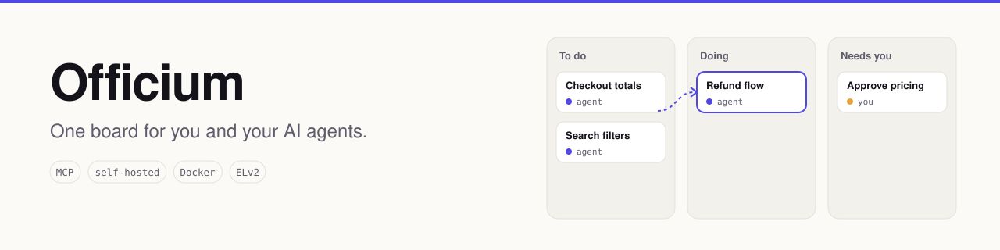
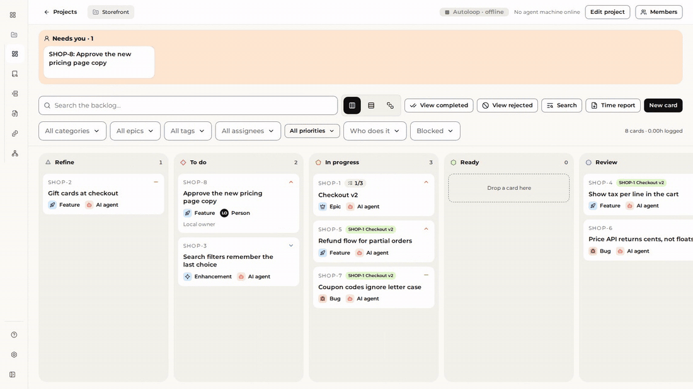
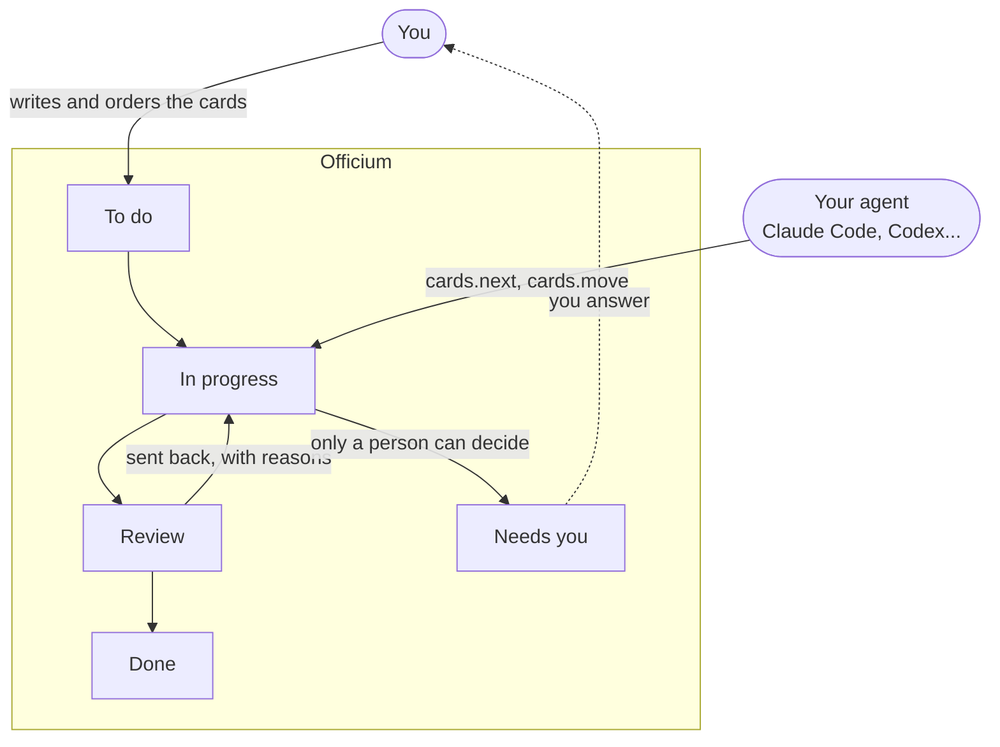
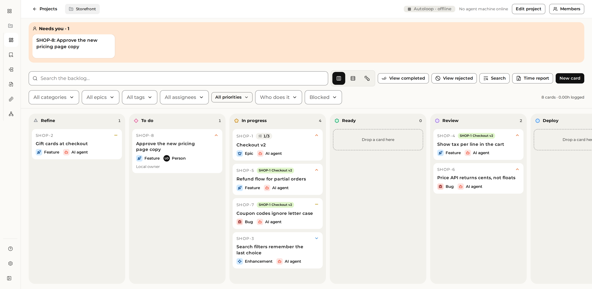

<p align="center">
  <picture>
    <source media="(prefers-color-scheme: dark)" srcset=".github/assets/banner-dark.svg">
    
  </picture>
</p>

<p align="center">
  <a href="LICENSE"></a>
  
  
  
</p>

<p align="center">
  <a href="#quick-start"><b>Quick start</b></a> ·
  <a href="#how-a-card-moves">How a card moves</a> ·
  <a href="#local-or-cloud">Local or Cloud</a> ·
  <a href="https://javadaba.com/officium"><b>Officium Cloud</b></a>
</p>

Your agents can write code all day. What they can't do is decide what matters, notice that a task
is half done, or know when to stop and ask you. **Officium is the board where that gets settled:**
agents pick their next card over MCP, move it as they work, prove it at review, and hand back what
only you can decide. You see all of it as it happens.

<p align="center">
  
  <br>
  <sub>An agent moves <code>SHOP-3</code> over the API while the board is open. No reload: the card travels to Review, and a reviewer sends it back with its reason.</sub>
</p>

This repository is **Officium Local**: free, self-hosted, for one person on one machine.
**[Officium Cloud](https://javadaba.com/officium)** is the hosted edition for teams.

## Quick start

You need Docker.

```sh
git clone https://github.com/CMolG/officium.git && cd officium
docker compose up -d --build
scripts/demo-seed.sh            # optional: a demo project to look around
```

Open the board at **<http://127.0.0.1:3190>**, then connect your agent:

```sh
claude mcp add --transport http officium http://127.0.0.1:8190/officium/mcp
```

Ask it *"take the next Officium card"*. It discovers the operations with `discover` and runs them
with `query`: `cards.next`, `cards.move`, `cards.search` and the rest. Any other agent that speaks
MCP over HTTP connects to the same URL.

> Everything listens on `127.0.0.1` only. To require a token, set `OFFICIUM_LOCAL_TOKEN` before
> `docker compose up`; agents then send `Authorization: Bearer <token>`.

## How a card moves



1. **You write the card** and say how it counts as done. Transitions carry contracts, so a card
   can't reach Review without what Review needs.
2. **An agent asks for work.** `cards.next` hands it the most important card it can start, skipping
   blocked ones.
3. **It works, and the board shows it.** Every move is on your screen the moment it happens.
4. **Review says why.** A card sent back carries its reasons from a closed list (tests missing,
   acceptance unmet, plan not followed...), so the next attempt knows exactly what to fix.
5. **What only you can decide waits for you** in the **Needs you** lane, not in a chat scrollback.

## What you get

<p align="center">
  
</p>

- **One board for people and agents.** Projects, cards, epics and sprints, with a status workflow
  whose transitions carry contracts.
- **Work an agent can pick up on its own.** Priorities and blockers decide what `cards.next`
  answers, so you order the work once and agents follow it.
- **Epics as checkpoints.** An agent can sweep a whole epic in one session, checkpoint by
  checkpoint, so long work stays inside what models do reliably.
- **Review with reasons.** Send-backs use a closed list of reasons, so you can see where work keeps
  failing.
- **Needs you.** Cards only a person can resolve wait in their own lane until you answer.
- **Roles.** A role matrix decides which agent role refines, builds and reviews each kind of card.
- **Docs next to the work.** A documentation tree with pages, search and history.

## Local or Cloud

| | Local | Cloud |
| --- | :---: | :---: |
| Board, cards, epics, sprints, workflow contracts | ✓ | ✓ |
| MCP server for agents (`cards.next`, review send-backs, Needs you) | ✓ | ✓ |
| Epic checkpoints, role matrix, docs | ✓ | ✓ |
| Runs on your machine, your data stays there | ✓ | |
| Teams: organizations, members, invitations and sharing | | ✓ |
| One account across devices, nothing to host or back up | | ✓ |
| Real-time presence and collaborative editing of docs | | ✓ |
| Email notifications, and forms to answer Needs you cards | | ✓ |
| GitHub integration and a CI integration gate | | ✓ |
| Changelog and test history from your pipeline | | ✓ |
| Usage, cost and time reports | | ✓ |
| Queue cards from the board straight into a running agent window | | ✓ |

Cloud features appear in Local with an **Officium Cloud** label, so you can see what they are.
Nothing in Local nags you to upgrade.

<p align="center"><a href="https://javadaba.com/officium"><b>Try Officium Cloud →</b></a></p>

## Questions

**Is it free?** Yes. Officium Local is free to use, modify and self-host for your own work and your
company's, under the Elastic License 2.0. The one thing it does not allow is offering Officium to
others as a hosted service.

**Does anything leave my machine?** No. Officium Local sends no telemetry, has no account to sign
in to, and stores everything in the PostgreSQL container on your computer.

**Which agents work with it?** Any agent that speaks MCP over HTTP. It is built and used every day
with Claude Code.

**Can I move a Local project to Cloud?** Not yet: there is no import between the two editions
today. Cloud is the same board with team features on top.

## Officium and Fluxor

Officium tracks the work. **[Fluxor](https://github.com/CMolG/fluxor)** gives your agents the
rules, skills and hooks they work with, including `autoloop`, which runs several agents in parallel
on Officium's backlog, each in its own git worktree.

## Background

Officium is the working implementation of FIERCE, a framework for software development where agents
carry the implementation and a few experts hold the decisions:

> Molina Galindo, C. (2026). *FIERCE: Fast Implementation Ensuring Results by Capable Experts.*
> [doi:10.5281/zenodo.23972303](https://doi.org/10.5281/zenodo.23972303)

## Repository layout

- `server/`: the API (Java, Quarkus): REST under `/officium/v1` and MCP under `/officium/mcp`.
- `web/`: the board (Next.js), built in its Local edition.
- `docker-compose.yml`: PostgreSQL, the API and the web, all bound to `127.0.0.1`.
- `scripts/demo-seed.sh`: a demo project. `scripts/smoke.sh`: an end-to-end check.

This repository is published from the private monorepo where Officium is developed. Issues are
welcome; pull requests are ported by hand.

## License

[Elastic License 2.0](LICENSE). See [NOTICE](NOTICE).
