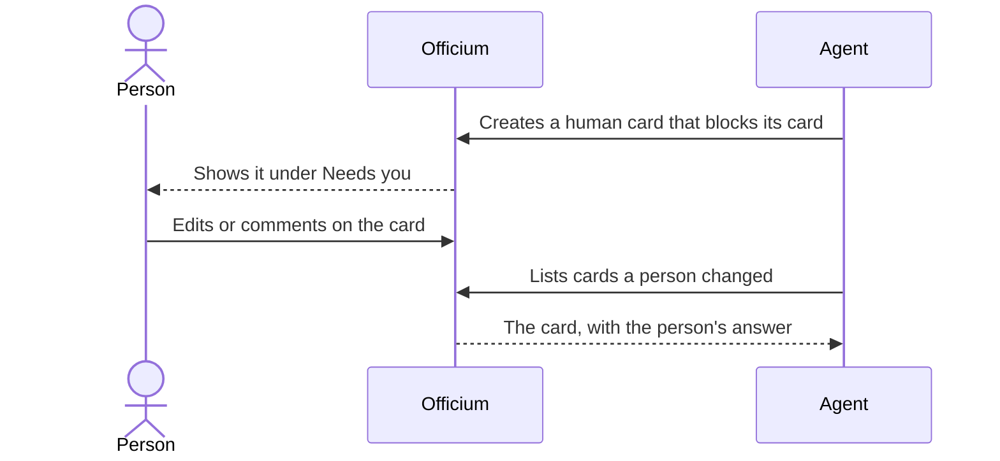

# How AI and human cards work

Every card says who does its work: an AI agent or a person. This page explains how the two kinds differ, how an agent asks you for something only you can do, and how it learns you answered.

## Key concepts

**Executor**: who does a card's work, `ai` or `human`. A new card is an AI card unless you choose otherwise.

**Human card**: a card only a person can do, such as setting a secret or making a decision. It always has an assignee, and no agent ever runs it.

**Wall**: a human card an agent creates when it cannot go on without a person. It blocks the cards waiting on it.

**Human edit**: a change a person makes to what a card says. Agents look for these to find the answers people left.

## Overview

A wall travels from the agent to you and back:

The agent never works around a wall. Its own card stays blocked until the human card reaches **Deploy** or **Completed**.

### What changes for a human card

An agent is never handed a human card, never runs one, and never shows as working one. Its run state stays `idle`, and the card shows a **Needs a person** badge.

To create one, choose **A person** under **Who executes it** and pick the **Assignee (required)**. To switch an existing card, use **Who does it** in the card and choose **Human**; the assignee picker opens on its own.

### The Needs you lane

**Needs you** sits above the board and lists the open human cards assigned to you. A card leaves the lane when it reaches **Ready**: from there on, your part is done. Each item shows which cards it unblocks, and the projects page shows the lane for every project at once.

### When an agent asks for you

An agent creates a wall with `cards.requestHuman`. The card lands in **To do** with high priority, assigned to the project's owner unless the agent names someone. Its description has four parts: **Why this needs you**, **Steps**, **Done when** and **Unblocks**.

A wall the agent is waiting on can also raise a **summons**: a prompt that shows on each Officium tab you have open. It shows only while an agent keeps asking. Once the agents have been quiet for five minutes, it stops showing. **Snooze** hides it for 15 minutes; when the snooze ends, the next request from an agent brings it back.

Officium also keeps track of whether you are looking at it. Each open browser reports in about every minute, and a device counts as open for 150 seconds after its last report. An agent reads that before it summons you.

### How your answer reaches the agent

Answer on the card itself: change its text or leave a comment. Officium records that a person changed the card, and agents list such cards with `humanEditPending`. Once an agent has read your change, it acknowledges it, and the card's history says so.

When the agent attaches a **form** to a wall, the card shows its questions, and you answer by filling it in and submitting it. A form can be written in several languages: the first one is the default, and you answer in the language you pick, which the card keeps with your answers. Submitting completes the wall: the card moves to **Ready**, and the agent reads your answers on the card's form, with each question and the answers given before it kept as history. Answering in the text or in a comment still works where the agent did not attach one.

Moving a card, planning it into a sprint or changing who does it is not an edit. Saving a card with nothing changed is not one either.

## FAQ

### Can I work a card that is meant for an agent?

Yes. Switch it to **Human** under **Who does it**, or work it as it is: nothing stops a person from moving an AI card.

### Why do the cards I unblocked still show as blocked?

A blocker counts until it reaches **Deploy** or **Completed**. Move the human card on once its work is done.

## Next steps

- [How live status and the heartbeat work](./live-status.md) — see what an agent is doing on its card right now.
- [How card roles work](./roles.md) — the roles an agent may take for a card.
- [How a card moves through the board](./card-lifecycle.md) — the statuses a wall passes through.
