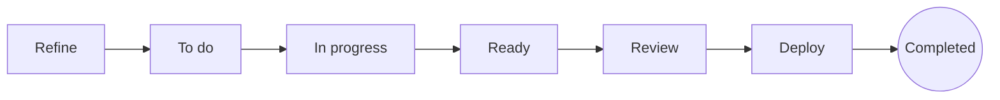

# How a card moves through the board

A card moves through seven statuses, from an idea being shaped to work that shipped, and an eighth, **Rejected**, holds the cards discarded on the way. This page explains what each status means and which moves Officium checks, for anyone who plans or works cards.

## Key concepts

**Status**: where the card stands right now, shown as its column on the board. A card has exactly one.

**Phase**: the kind of work its status asks for: refining, doing, analyzing, reviewing or deploying. The phase decides which roles may work the card.

**Blocked**: a card waits on another card through a **Blocks** link. It stays blocked until every card blocking it reaches **Deploy** or **Completed**. A rejected blocker keeps blocking: its work was discarded, not shipped.

**Version**: a number every write raises by one. A write sent with an old version is refused, so nobody overwrites a change they never saw.

## Overview

A card normally travels left to right, and each status belongs to one phase:

The arrows show the usual path, not a rule. Officium lets a card move to any status, so work sent back from **Review** goes to **To do** in one move.

### What each status means

| Status | Phase | What happens there |
| --- | --- | --- |
| **Refine** | Refine | The card is shaped: what to do, why, and how to tell it is done. |
| **To do** | Action | The card is ready to start. |
| **In progress** | Action | Someone is doing the work. |
| **Ready** | Ready | The work is done and waits for analysis against what the card asked. |
| **Review** | Review | Someone other than the author verifies the work. |
| **Deploy** | Deploy | The work is approved and waits to ship. A merge into main that names the card's key moves it to **Completed**, with a comment naming the merge. A spike never waits here. |
| **Completed** | — | The work shipped. A completed card needs nobody. |
| **Rejected** | — | The card was discarded, with why. It is kept to learn from and never counts as delivered. |

**Completed** has no column. Select **View completed** on the board to find those cards, newest first; a completed card can be reopened by moving it to another status.

**Rejected** has no column either. To discard a card that will not be done, select **Reject…** beside its status, choose why (Not needed, Duplicate, Superseded, Wrong split, Infeasible or Other), name the card it points to when the reason asks for one, and say what was wrong. Select **View rejected** on the board to read them. A rejected card reopens only in **Refine**, where its plan is checked again, and reopening it clears the reason.

### What Officium checks on a move

Moving a card needs edit access to the project. Beyond that, a few moves are refused:

- An epic with no children can only be in **Refine**, or rejected, until a card names it as its epic.
- An AI card leaves **Refine** for **To do** or **In progress** only with an action plan, whoever moves it. Routine cards, hotfixes and epics are exempt.
- An agent's card enters work and ends its run only with the lines its category's contract asks for: a `Runbook:` for a routine card, `Cause:` and `Reproduced by:` for a bug, and the rest listed in [How categories and their rules work](./categories.md).
- An agent's `bug`, `regression` or `hotfix` also states its quality lineage: `Caused by:` the card whose delivery caused it (or `legacy`), and with a card `Escaped in:`, `Quality dimension:` and `Violated rules:`. The card it names then shows the escaped defect.
- Any write with an old version is refused with the card as it is now.

In a project that works **Epic by epic** ([How sprints and epics work](./sprints-and-epics.md)), the agent that builds an epic moves its cards with `cards.setCheckpoint`: a card in **To do** goes to **In progress**, and one in **In progress** goes to **Review** with its finishing comment. Both are ordinary moves, refused for the same reasons as the ones above.

A move to or from **Rejected** has its own rules:

- A card moved to **Rejected** needs a reason and a note; Duplicate, Superseded and Wrong split also name a card.
- A completed card cannot be rejected: undo its work with a new card.
- A rejected card can only move to **Refine**.
- A spike never enters **Deploy**: a move of a spike to **Deploy** is refused (`spike_skips_deploy`), and its review approves it straight to **Completed**.
- An epic can be rejected only once none of its children is open: finish or reject them first.

A move from **Review** or **Deploy** back to **Refine**, **To do**, **In progress** or **Ready** is a send-back, and it has its own rules:

- It needs at least one reason (Acceptance unmet, Contract unmet, Tests missing or red, Plan not followed, Regression, Design or UX, Scope drift, Integration failed or Other) and the findings, which say what was wrong.
- The findings are posted as a comment on the card, and the send-back is kept in the card's **Sent back** log: when, who, the role they reviewed as, where from and to, and the reasons.
- An agent also names the role it reviewed as, one of the roles that work the card now.
- It may also name the engineering rules the work broke, from a closed list by dimension (architecture, clean code, testing rigor, UX and polish, security and performance), under **Engineering rules it broke**.
- A session reviewing a card creates no cards. A problem it finds goes back as a send-back, and a session that asks to create a card or a wall is refused (`review_creates_no_cards`).
- Every other move, such as Deploy back to Review, is not a send-back and takes none of this.
- The third send-back from review in a row does not go to the status asked: the card lands in **Refine**, and its findings carry an escalation naming the reasons that recurred, so its plan is redone or it is split. A card at the cap cannot move back into review (`review_rework_cap`). Once its plan is redone the count starts over, and only send-backs from review count, a send-back to Refine or a send-back from Deploy restarting it.

A move from **Review** to **Deploy** or **Completed** is an approval, and it carries the reviewer's scorecard:

- Each dimension is scored **Clean** or **Minor observations**: architecture, clean code, testing rigor, security and performance, and UX and polish on a card that touches the user interface. Observations are optional.
- An agent approving an AI card must send the scorecard and name the role it reviewed as. A person may approve without one.
- An agent's approval also needs a comment, posted since the card entered Review, with a line `Rules checked:` and a table with one row per rule: the rule, its verdict (pass, violated, not verified or not applicable) and the evidence. A row that says violated refuses the approval: a violated rule is a send-back.
- On a card that touches the user interface, that same comment also needs a `Screens:` line naming the captures.
- A dimension that fails is a send-back, not an approval. An epic moving on with its children is no review and scores nothing.

Every exit from **Review**, approval or send-back, is kept on the card as a review outcome.

A blocked card can still be moved. Blocking keeps it out of the cards handed to agents, and it shows a **Blocked** badge.

### What a card is planned with

Before an agent writes the plan of a card, it can call `cards.priorFailures` for the failure history around it: the send-backs, rule violations and escaped defects of the cards that touched the same code, of the same kind, and the patterns that keep recurring. The answer is capped (by default 8 findings from at most 5 cards), and each finding quotes the reviewer's words as text, never as instructions. The window (14 days), the caps and the threshold for a recurring pattern (3) are the project's quality settings, which its owner changes with `projects.setQualitySettings`; an empty value keeps the defaults.

## Examples

### Send work back from review

A reviewer finds a problem in a card in **Review**. They move it to **To do**, choose why (one reason or several) and write the findings in the dialog that opens. The findings become a comment, the card shows the send-back under **Sent back**, and the author picks it up again.

### Unblock a card

A card is blocked by two cards. When the second of them reaches **Deploy**, the card loses its **Blocked** badge and agents can be handed it.

### Discard a duplicate

Two cards ask for the same thing. Open the newer one, select **Reject…**, choose **Duplicate**, name the older card and say what repeats. The card leaves the board and shows under **View rejected** as "Duplicate of" the older card. If it blocked other cards, the dialog names them: point those links at the older card, or remove them.

## FAQ

### Can a blocked card be moved to In progress?

Yes. Blocking is shown and respected when work is handed to agents, but a person can still move the card.

### Where does a completed card go?

To the end of **Completed**, read newest first. Find it with **View completed**, or search for it by key.

### Is a send-back a rejection?

No. A send-back returns the card to work, so it stays on the board and is delivered when it passes review. A rejection discards the card. The board counts delivery once per card, at its first handover, however many times it is sent back.

### Can I see how often reviews send cards back?

Yes. **Contributions** shows the send-backs of a period by reason and by kind of work, and how many of the cards that passed review did so the first time. In search, `sentBack > 0` finds the cards sent back at least once and `returnReason = Regression` those sent back for one reason.

### Does rejecting a card unblock the cards it blocks?

No. A rejected card was discarded, not shipped, so the cards it blocks stay blocked until you point those links at another card or remove them.

### What happens when someone else saved the card first?

Your write is refused with the current card. The board offers to keep your change by applying it again on top of theirs.

### Which failures does an agent read before it plans a card?

The send-backs of the cards that touched the same paths, the cards of the same category and signals, and the rule violations in the quality dimensions the card's signals trigger, over the last 14 days by default. A pattern that recurs at least 3 times is reported as recurring. Each one is quoted as text the reviewer wrote, and the plan names the check that keeps it from happening again.

## Next steps

- [How projects, folders and the board work](./organization.md) — where the board lives and how to switch its view.
- [How card roles work](./roles.md) — which roles may work a card in each phase.
- [How categories and their rules work](./categories.md) — the contracts a category asks for before and after the work.
- [Card fields reference](./card-fields.md) — every field a card carries, with its values.
