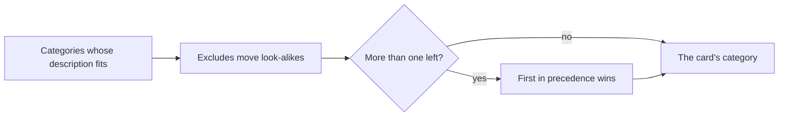

# How categories and their rules work

A card's category says what kind of work it is, from a bug to a spike. This page explains how a category is chosen, what its contract asks of a card, and which of those rules Officium enforces.

## Key concepts

**Category**: the kind of work a card is, one of fifteen. A card may have none until someone classifies it.

**Contract**: what a category asks of a card before work starts and what done means. Agents read it before they work the card.

**Exclude**: a note in a category saying where a look-alike belongs instead. A fix for something that worked before a recent change is a regression, not a bug.

**Classifier precedence**: the order that breaks a tie when a card fits several categories. The first category in the order wins.

## Overview

Classifying a card narrows the categories down in three passes:

An epic never comes out of this: a card is an epic because it groups other cards, not because of its wording.

### The categories

| Group | Categories |
| --- | --- |
| Product and user value | **Epic**, **Feature**, **User story**, **Enhancement** |
| Corrective and stability | **Bug**, **Hotfix**, **Regression** |
| Technical and platform | **Refactor**, **Technical debt**, **Infrastructure**, **Security** |
| Research and quality | **Spike**, **Testing**, **Routine**, **Documentation** |

When a card fits several, the order is: hotfix, security, regression, bug, spike, routine, feature, user story, enhancement, infrastructure, refactor, technical debt, testing, documentation.

### Where you read a category's rules

The card shows its category's one-line hint. Select the **i** button next to it to read **Before work starts**, **Done means**, and when a card is not of that category. The **Categories** page in the sidebar has one sheet per category: **Is it this category?**, **The contract** and **Who works it**.

### What Officium enforces

Most of a contract is guidance that agents follow. Officium checks these rules itself:

- A `routine` card created without a status starts in **To do**, and so does a `hotfix` whose description already has its entry lines; any other card starts in **Refine**.
- An epic with no children stays in **Refine**, is never planned into a sprint and is never run.
- An AI card leaves **Refine** for **To do** or **In progress** only with an action plan; routine cards, hotfixes and epics are exempt.
- A spike never enters **Deploy**: its review approves it straight to **Completed**, and a move of a spike to **Deploy** is refused (`spike_skips_deploy`).

An agent's card enters work (leaves **Refine** for **To do** or **In progress**) only with its category's entry lines in the description, and ends its run (reaches **Review**, **Deploy** or **Completed**) only with its exit lines in a comment posted since it last entered **In progress**:

| Category | To enter work | To end its run |
| --- | --- | --- |
| `routine` | `Runbook:` | Any comment with the run's evidence |
| `bug` | Its lineage (below) | `Cause:` and `Reproduced by:` |
| `regression` | `Last good:`, `First bad:` and its lineage | `Caused by:` naming the commit, `#PR` or URL that broke it |
| `hotfix` | `Impact:`, `Affected version:`, `Reproduction:` and its lineage | A linked `bug` or `regression` card |
| `technicalDebt` | `Slows down:` or `Risk:`, and `Cost of not paying:` | — |
| `refactor` | `Restructured because:` and `Ends in:` | `Public contracts:` |
| `enhancement` | — | `Public contracts:` |
| `infrastructure` | `Topology:`, `Cost and capacity:` and `Rollback:` | `Proven by:` and `Observed by:` |
| `spike` | `Question:`, `Time box:` and `Success criterion:` | — |
| `testing` | `Covers:` and `Left out:` | `Gate:` |
| `documentation` | `Audience:` and `Purpose:` | `Verified against:` |
| `userStory` | — | Every card blocking it in **Deploy** or **Completed** |

A missing line is refused with `contract_unmet`, naming the line to write. The board checks that a line is there; whether it is true is the reviewer's. These rules apply to agents on AI cards only. A person is never refused, and neither is a human card.

### A corrective card's quality lineage

A defect that comes back after a card was planned, built and approved is charged to that card. A `bug`, `regression` or `hotfix` states where it came from with four description lines, and a `refactor`, `technicalDebt` or `enhancement` does too when it corrects an earlier card's delivery:

- `Caused by:` the key of the card whose delivery introduced or approved the defect, or `legacy` when it predates the lineage or no card can be named. `legacy` needs no other line.
- `Escaped in:` `refine` (its plan missed it), `action` (its implementation introduced it) or `review` (its review approved it).
- `Quality dimension:` `architecture`, `clean_code`, `testing_rigor`, `ux_and_polish`, `runtime_guardrails` or `functional`.
- `Violated rules:` the rules it broke, written `<dimension>:<rule>` from the closed list `meta.states` serves as `qualityRules`, or `none`.

When the card enters work or ends its run with a lineage that names a card, Officium links both cards and keeps the escaped defect on the card it names: its **Escaped defects** section lists each corrective card, the phase that let the defect through, the dimension and the rules.

## FAQ

### Does every card need a category?

No. A card can stay without one, and it then gets only its signals' roles. Classifying it is usually part of refining it.

### Can a project change a category's contract?

No. The contracts are the same in every project. What a project changes is which roles work each category.

## Next steps

- [How card roles work](./roles.md) — the roles each category brings in per phase.
- [How a card moves through the board](./card-lifecycle.md) — the statuses a contract talks about.
- [Card fields reference](./card-fields.md) — the category and signal values as agents send them.
