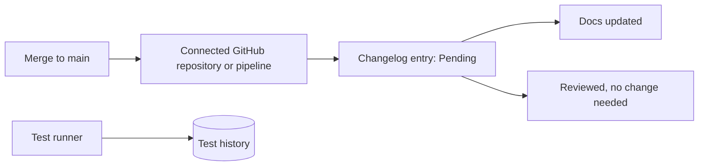

# How documentation, the changelog and test history work

Each project has a **Documentation** section: its own pages, a changelog of every merge, and the history of its test runs. This page explains how the three keep a project's documentation from going stale without anyone noticing.

## Key concepts

**Page**: a Markdown document at a path, like `procedures/deploy`. People edit it in the browser, where they read it, and it saves as they type; agents read and write it through the MCP server.

**Unpublished draft**: a page only its creator sees, until they publish it.

**Archived page**: a published page taken out of the tree and the search. It stays readable until someone unarchives it.

**Trash**: where a deleted page waits for 30 days before it is gone for good.

**Star**: a page or collection you keep at the top of the sidebar. Stars are yours alone, in your own order.

**Recent**: the pages you opened last, newest first. It is yours alone and keeps the last 50.

**Template**: a page to start new pages from. It is not in the tree or the search, and a page made from it gets its text with `{date}`, `{time}`, `{datetime}` and `{author}` filled in.

**Officium's own pages**: the pages under `officium/`, the same in every project. Officium keeps them current, so nobody can edit, move or delete them.

**Changelog entry**: one change that reached the project's main branch. It stays pending until someone says what the documentation did about it.

**Pipeline token**: a credential for a CI that is not GitHub. With it, the pipeline records changelog entries and test runs. A project on GitHub does not need one.

## Overview

Code reaches the main branch, and the documentation has to answer for it:

The number of pending entries is how stale the documentation might be. **Documentation** in the sidebar shows it as a badge.

### Pages

A path is up to 8 segments of lower-case letters, digits and single hyphens, joined by `/`, and 200 characters at most. Capitals are lowered and outer slashes dropped; anything else is refused, never rewritten. The page tree follows the paths, so `procedures/deploy` sits under `procedures/`. Folders start collapsed: open the ones you need, and Officium remembers them in this browser; the folders above the page you are reading always open. While you drag a page by its grip, a dashed row shows exactly where it will land, and a collapsed folder opens when you hold the page over it.

Every save names the version it started from. If someone saved in between, nothing is overwritten: you see both versions and choose. Pages hold text, diagrams, and the images and files you add to them.

A page you create in the browser is an **unpublished draft**: only you can see it, in the tree, in search and for agents, until you select **Publish**. Its title and its row in the tree say **Draft**; a published page carries no label. **Archive** takes a published page out of the tree and the search without deleting it, and **Unarchive** brings it back. **Delete** moves a page to the **Trash** with an **Undo**, and its path is free meanwhile. A trashed page counts against your storage until it is gone, and it is deleted for good after 30 days, or at once with **Delete forever**, which asks for the title. **Unpublished drafts**, **Archive** and **Trash** sit under the changelog in the page tree; the trash is for editors.

When you read a page, its title and tools stay at the top while the text scrolls, and the sidebar and **Contents** each scroll on their own. **Contents** starts closed: select it, or press <kbd>Ctrl</kbd> + <kbd>Alt</kbd> + <kbd>H</kbd>, to list the page's headings beside the text and jump to one. Every page reads at full width. **Page options** shows its word count and reading time, and copies or downloads it as Markdown, exactly as stored. The pages under the open one are listed below its text.

### Finding your way

Press <kbd>Ctrl</kbd> + <kbd>K</kbd> (<kbd>⌘</kbd> + <kbd>K</kbd> on a Mac), or select **Search pages** at the top of the sidebar, to open the command menu. Type part of a title or a path and press <kbd>Enter</kbd> to open the page. With nothing typed it lists what you starred and opened last, the sections, the open page's actions (a blocked one says why), and **New page**. If nothing matches, an editor is offered to create a page with the words you typed as its title.

To search the text of every page, choose **Search the text of every page** in the command menu, or **Search page text for “…”** once you have typed something. The **Search** section ranks pages whose title or path match first, shows where each one matched, and matches the start of a word (`depl` finds `deploy`). Put words in quotes for a phrase (`"edit session"`), write `OR` between alternatives, and put `-` before a word to leave out the pages that have it. The filters narrow by collection, author, when a page was last updated, and its state (published, your unpublished drafts, archived); the address keeps your search and filters, so Reload and Back return to them. Agents search the same way with `docs.search`.

Select **Star** on a page, or **Star collection** in a collection's menu, to keep it under **Starred** in the sidebar. Drag a row by its grip, or press <kbd>Alt</kbd> + <kbd>↑</kbd> or <kbd>↓</kbd> on its name, to put your stars in order. A star follows its page when the page is moved or renamed, and it hides while the page is in the trash. Any member can star pages, a viewer too, and nobody sees another person's stars. **Recent** sits under the changelog in the tree and lists the pages you opened, with when. An agent reading a page does not add it to your **Recent**.

Press <kbd>?</kbd> for the list of keys; <kbd>Ctrl</kbd> + <kbd>.</kbd> hides or shows the sidebar. These keys wait while you type in a field or the editor. Drag the edge of the sidebar, or focus it and use the arrow keys, to resize it between 208 and 480 pixels; double click puts it back. Both choices are remembered for you on this browser.

### Templates and Markdown files

Open **Templates**, under **Recent** in the page tree, to see the project's templates: the project's own, offered in every collection, then each collection's. Select **New template** there, or **New template here** in a collection's menu, to start a blank one, and choose **Where** it goes. To turn a page into one, open **Page options** and select **Make a template**: a copy becomes the template, and the page stays as it was.

To start a page from a template, pick it under **Start from** when you create a page, or select **New page from this template** on the template. The title shows filled in before you create it. The variables are `{date}` (like 2026-10-13), `{time}` (15:42), `{datetime}` and `{author}`, in your own time zone; any other text in braces stays as written. A template can't be archived or moved: delete it instead. An agent makes one with `template: true` on `docs.upsert`, and starts a page from one with `fromTemplate`.

Drop `.md` or `.txt` files on a collection or a page in the tree to add them as pages under it, or select **Import Markdown files…** in its menu. Each file becomes one published page, titled from its first heading, or else from its file name. If the storage is full, the import stops and says which files it left; the pages it already added stay, and **Undo** moves them to the trash.

### Page history

Each time a page is saved, the version it replaces is kept. The saves of one editing visit count as one: within 5 minutes of its first save, a visit's later saves keep no version of their own, so the history is never a version per pause. Per page, Officium keeps exactly two kinds of version: the **heaviest version ever**, which never expires, and the **two latest previous versions**, which expire after the project's window (15 days by default). Select **History** on a page to see them beside its text, with each one's size, author, date and when it expires.

For each kept version you can **Compare** it with the current text, **Restore** it, **Download** it as Markdown, or **Delete** it. Restoring writes a new version, so you can undo it by restoring the version it replaced. Deleting is final, even for the heaviest, and asks you to type the page's title.

The project's owner sets the window under **Configuration** > **Documentation settings** (the History panel's **History settings** link opens it), from 0 to 3650 days. 0 keeps only the heaviest version. A shorter window applies to kept versions at once. Kept versions count against the owner's storage; if the owner's storage is full, a save still succeeds but its previous version is not kept, and you are told.

### Comments

Select some text on a page and choose **Comment** to start a thread about those words. The words are then underlined: point at them to see their thread, and select them to keep it open and reply. **Comments**, at the end of the page, holds its general comments: those about the whole page, and those whose words are no longer on the page, which keep their quote and say so. The threads about text are listed there too, under **On passages of the text**. Nothing is written into the page: a comment is kept apart, tied to the words it quotes, and it follows them wherever they stand in order, even after the page is edited or moved.

A thread takes replies, one level deep. **Resolve** puts it behind the **Resolved** filter, and **Reopen**, or a new reply, brings it back. Each comment takes one emoji from each person, and shows who reacted. Editors and owners comment; viewers read. You edit your own comments; you or the project's owner delete one, and a deleted first comment that has replies stays as "Comment deleted" so the replies keep their thread. Archived pages and Officium's own pages take no comments. An unpublished draft's comments are its creator's.

Comment text and the words they quote count against the owner's storage, shown as **Comments** in the documentation settings. Agents list a page's threads, or every open thread in the project, and answer and resolve them with `docs.comments.list`, `docs.comments.add`, `docs.comments.resolve` and the rest of the `docs.comments.*` operations.

### The changelog

Open **Changelog** at the top of the page tree. Each entry shows the change, the areas of code it touched, and its answer:

- **Pending**: nobody has said yet whether the documentation needed it.
- **Docs updated**: someone updated pages for it, listed under **Pages updated:**.
- **Reviewed, no change needed**: someone checked, and no page needed it.

Answer an entry with **No change needed** or **Pages updated…**, and select **Reopen** to take an answer back. Answering needs edit access.

The changelog records itself. The project's owner selects **Connect your pipeline**, which opens **Documentation changelog** in **Integrations**, and has three ways, in this order:

1. **Connect a GitHub repository.** Every merge to the repository's default branch is recorded as a pending entry, with nothing to install and nothing to paste. The section shows which repository is connected, and the owner connects one in **GitHub repositories**, above it.
2. **Test runs** come from the computers you connected as agents in **Integrations**. Each run uses that computer's own token.
3. **Another CI** uses a pipeline token. Select **Create token**, store it in your CI as a secret named `OFFICIUM_CHANGELOG_TOKEN`, and add the step the section shows. The token is shown once.

### Bulk import

An agent can import many pages at once without sending each page through its conversation. It asks Officium for a one-time import code, which reaches this project's documentation only, lasts 15 minutes, and closes when the import is done. Every page written this way follows the same rules as a page written by hand.

### Test history

Open **Test history**, next to **Changelog**. A computer connected as an agent in **Integrations** records its full test runs here without a pipeline token, as long as its account can edit the project. Each run records every suite's result and duration, with the commit and the computer it ran on. A suite shows **Getting slower** when its latest passing run takes more than 125% of its recent median and at least 10 seconds more. The median covers its last 10 earlier passing runs, and it needs at least 5.

## FAQ

### Can I change one of Officium's own pages?

No. They are the same in every project and Officium keeps them current. Write your own page at another path.

### What happens if the pipeline token is revoked?

A CI that uses it stops recording merges and test runs, and nothing warns it. The owner creates a new token under **Documentation changelog** in **Integrations**. A connected GitHub repository, and test runs recorded from connected computers, are not affected.

### Does a deleted page keep its history?

Yes, while it waits in the trash: **Restore** brings it back with its kept versions. Deleting it for good, with **Delete forever** or after 30 days, removes its kept versions too.

### Who can see my unpublished draft?

Only you, and an agent working with your account. Another member who tries your draft's path is told the path is taken, without seeing the page.

### Does starring a page change it for anyone else?

No. A star is only a bookmark of yours: it does not touch the page or its version, and others do not see it. Starring a collection that only exists through its pages writes its empty layout row, which changes nothing anyone sees.

### What happens to my stars and Recent when I leave a project?

They are erased once you can no longer open the project: when you are removed from it, removed from the team that gave you access, or that team is deleted or loses the project. If you still have another way in, such as your own membership or another team, you keep them. Being invited again starts you with none.

### Can I see who else is on a page?

Yes. People who have the page open appear as initials beside its path: up to four, then **+N**, and a tap lists everyone. Someone with the editor open is marked with a pencil and the word **editing**. You never see yourself, and an agent is never listed: it shows as the page's last editor instead. When an agent saves while you read, the new text replaces the old in place, the header says **Updated just now by** the agent, and your scroll position stays.

## Next steps

- [Write a documentation page in Officium](./write-a-page.md) — create a page, link it and answer the changelog.
- [Connect an agent to Officium](./connect-an-agent.md) — let an agent read and update the pages.
- [How projects, folders and the board work](./organization.md) — where the Documentation section sits.
