# How live status and the heartbeat work

Officium shows which cards an AI agent is working right now and what it last said it was doing. This page is for anyone who watches a board while agents work it, and for whoever sets up the agent's machine.

## Key concepts

**Session**: the period an agent is known to be working one card. It starts with the agent's own call and ends when the agent stops, moves the card on, or goes silent.

**Lapse**: a session ends 10 minutes after the agent's last sign of life. A silent agent is taken as gone, so a card never shows as worked forever.

**Status line**: a short note an agent sends while it works, such as `running the e2e suite`. It is live monitoring, never saved to the card's history.

**Autoloop**: a supervisor on your computer that runs the backlog with several agent sessions at once, each on its own card. It beats Officium every 20 seconds, saying whether it runs or waits.

**Heartbeat**: a hook on the agent's computer that renews its sessions on every tool call. It keeps a card live while the agent works without writing to Officium.

## Overview

A session lives between a start and a stop, and every sign of life pushes its end 10 minutes further:

```mermaid
stateDiagram-v2
  accTitle: The life of an agent session
  accDescr: Only the agent's own call starts a session; the agent's status lines and writes and heartbeats only keep it alive, and silence ends it after 10 minutes.
  state "Live" as Live
  state "Live, timer reset" as Renewed
  state "Ended by the agent" as Stopped
  state "Ended by silence" as Expired
  [*] --> Live: Agent starts work
  Live --> Renewed: Status, write or heartbeat
  Renewed --> Live
  Live --> Stopped: Agent stops or moves the card on
  Live --> Expired: 10 minutes of silence
  Stopped --> [*]
  Expired --> [*]
```

Only the agent starts a session. The agent's own writes and a heartbeat keep one alive, but a heartbeat never opens one. A person's edit to the card does not renew it.

### What starts and ends a session

An agent starts a session through the MCP server when it does any of these:

- Moves the card to **In progress**.
- Sets the card's run state to `running`.
- Marks the card as actively worked.
- Reports a status line.

The session ends when the agent moves the card to any other status, sets the run state to anything but `running`, or marks the card as no longer worked. Human cards and epics never get a session.

### Where you see it

A card with a live session shows a **Working now** pill and an animated border, and it sorts first in its column. The board's tray, **AI is working on N cards**, starts folded so the columns stay in view; select **Show the cards** to list every worked card with the agent, its computer, its model and its latest status line. Open, it never covers more than a third of the board, and the board remembers your choice in this browser.

Open the card to read the **Live status** section: every status line the agent sent, newest first. Officium keeps the last 50 lines and up to 500 characters per line. The projects page has its own tray, **AI is working in N project(s)**, for every project at once.

### Start and stop the autoloop from the board

The **Start Autoloop** / **Stop Autoloop** button sits left of **Members** on the board. It shows your own autoloops on the project:

| State | What the button shows | What it does |
| --- | --- | --- |
| Offline | **Stop Autoloop**, disabled | Nothing. Hover it to read why: no autoloop of yours has beaten in 90 seconds. |
| Idle | **Start Autoloop**, with a pulse | Your autoloop waits in standby. A click asks it to start, and its sessions begin asking for cards. |
| Running | Red **Stop Autoloop** | Asks **Are you sure you want to stop the autoloop?** first. On yes, every session stops; worktrees, claims and conversations are kept, and the loop waits in standby. |

The loop takes the order on its next beat, within about 20 seconds; until then the button reads **Starting…** or **Stopping…**. Only an editor or the owner can use it. An agent does the same with `autoloop.status`, `autoloop.start` and `autoloop.stop`.

To make the button useful, start the loop on your computer in standby: `/autoloop standby`. The autoloop skill beats with the computer's heartbeat token through its `remoteSwitch` setting.

## Examples

### An agent left a card half done

A session that ends by lapse leaves the card in **In progress** with nobody on it. The next agent session on the same computer asks for the cards it left behind (`cards.resumable`) and finishes them before picking new work.

### A long command keeps the card live

The heartbeat sends at most one beat every 10 seconds. While a shell command runs, it beats every 30 seconds with the command's description and elapsed time, for up to 11 minutes.

## FAQ

### Is a status line saved on the card?

No. Status lines are monitoring, not history, and they are lost when the server restarts. A finding worth keeping goes in a comment.

### Can the heartbeat start work on a card?

No. A beat only renews the sessions that account already has live on that computer. If none is live, the beat changes nothing.

### Why did a card stop showing as worked while the agent was busy?

Its session lapsed: nothing reached Officium for 10 minutes. Without the heartbeat, an agent busy for a long time between writes goes silent.

### Why does Start Autoloop stay disabled?

No autoloop of yours beat on this project in the last 90 seconds. Start one in standby on your computer (`/autoloop standby`), with the heartbeat token set up, and the button turns to **Start Autoloop** within 20 seconds.

## Next steps

- [How AI and human cards work](./ai-and-human-cards.md) — which cards an agent may work, and how it asks a person for help.
- [How time, tokens and metrics work](./time-and-metrics.md) — how a session turns into time on the card.
- [Connect an agent to Officium](./connect-an-agent.md) — set up the MCP server and the heartbeat token on a computer.
