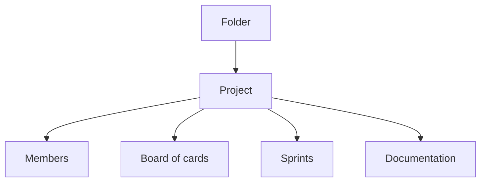

# How projects, folders and the board work

Officium keeps work in projects, and each project is one backlog with its own board. This page explains how projects, folders, members and the board's views fit together, for anyone starting with Officium.

## Key concepts

**Project**: one backlog, with its own cards, sprints and documentation. Every card key starts with the project's prefix, like `OFF-12`.

**Folder**: an optional group of projects, which can hold other folders. A folder only organizes your sidebar; it shares nothing.

**Member**: a person with access to a project, as **Owner**, **Editor** or **Viewer**. Editors change cards and sprints; viewers only read.

**Board**: the project's cards laid out by status. It shows them as columns, as one list, or as a stack of sections.

## Overview

A folder holds projects, and each project holds everything its team works with:

Access is decided per project, never per folder. Someone who is not a member gets no sign the project exists.

### Projects and members

To create a project, select **New project** on the projects page and give it a **Name** and a **Card key prefix**. The prefix takes 2 to 10 capital letters or digits, starts with a letter, and is unique among your projects.

The project's owner invites people with **Members**, by the email of their Javadaba account. Only the owner invites, changes roles, removes members, and changes the project's icon and color. **Organization**, under Configuration in the sidebar, lists everyone with access to your projects, and teams that grant access to a group at once.

Each owner includes up to three collaborators across all their projects: the same person on two projects counts once, and a viewer counts like an editor. Adding a fourth person is refused with a message that says the Business plan is needed, and nothing is added. Removing someone, or changing a role, is never refused. An owner who is already over three keeps everyone; they just cannot add anyone until they are back under the limit. The owner's collaborator count is shown in the Members dialog.

Right-click a project in the sidebar or on the projects page, or select its **More actions** button, to edit it, manage its members or delete it. **Delete project** is the owner's alone, and anyone else sees it disabled with the reason. It deletes the project for everyone, with its cards and its documentation, and it cannot be undone, so it asks you to type the project's name first. To put a project away without losing it, archive it instead.

### Folders

Select **New folder** on the projects page to create one. Folders appear in the sidebar under **All Projects**, and each project belongs to one folder at most. A folder with projects or subfolders in it cannot be deleted until you move them out.

### The board and its views

A project's sidebar opens its views: **Task Board**, **Search Tasks**, **Backlog**, **Contributions** and **Documentation**. The board's layout switch offers three views:

- **Board view**: one column per status, from **Refine** to **Deploy**.
- **List view**: every card in one list, ordered by **Sort by**.
- **Stack view**: one section per status, with the cards an agent is working right now first.

The board remembers your view per project. With nothing remembered, it opens the board view on a wide screen and the stack view on a narrow one.

Each view's title row names the project as a badge, with its icon. Selecting the badge switches to another project and stays on the same view.

Above the board, the **Needs you** lane lists the human cards assigned to you that are in **Refine**, **To do** or **In progress**, with the cards each one unblocks. The projects page shows the same lane across all your projects.

## FAQ

### Is the Backlog page the same as the board?

No. **Backlog** is where you plan sprints and move cards between them. The board shows the cards being worked, and only the active sprint's while a sprint runs.

### Can an editor rename a project?

Yes, through the API. The web's **Edit project** dialog opens only for the owner.

## Next steps

- [How a card moves through the board](./card-lifecycle.md) — the statuses behind the board's columns.
- [How sprints and epics work](./sprints-and-epics.md) — plan cards into sprints on the **Backlog** page.
- [How documentation, the changelog and test history work](./documentation.md) — the project's pages, next to its board.
