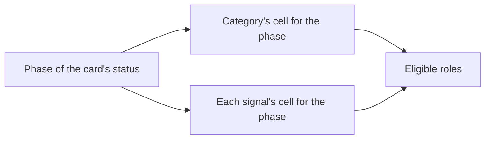

# How card roles work

An AI agent works a card under a role, like `frontend-developer` or `code-reviewer`. This page explains how Officium decides which roles a card allows and how a project's owner changes them.

## Key concepts

**Role**: the professional stance an agent takes for a card, named by an id in kebab-case. It is not a member's access to a project, which is **Owner**, **Editor** or **Viewer**.

**Phase**: the kind of work the card's status asks for. **To do** and **In progress** share the action phase; a completed card has no phase.

**Role matrix**: the project's table of roles, one cell per category or signal and per phase. Officium ships a default, and the project's owner can change any cell.

**Eligible roles**: the roles a card allows right now. Agents receive them with the card as `eligibleRoles`.

**Mod**: a rule an agent follows on top of its role, such as `rule-enforcer` or `dark-mode`. Mods come from Fluxor's catalog and are listed under **Mods** on the **Roles** page, each with its own sheet.

## Overview

A card's roles come from two rows of its project's role matrix, read at the column of its phase:



Signals only add roles on top of the category's. A card with no category gets only its signals' roles, and a completed card gets none.

### From status to phase

| Status | Phase |
| --- | --- |
| **Refine** | Refine |
| **To do**, **In progress** | To do & In progress |
| **Ready** | Ready |
| **Review** | Review |
| **Deploy** | Deploy |
| **Completed** | None: a completed card needs no one |

### Model and effort

Each category cell also says which **model** an agent works the card with, and how much **effort** (reasoning) it spends: low, medium, high, xhigh or max. By default:

| Phase | Model | Effort |
| --- | --- | --- |
| Refine | Opus 5.5 | xhigh |
| To do & In progress | Sonnet 5.5 | medium |
| Ready | Opus 5.5 | high |
| Review | Opus 5.5 | high |
| Deploy | Sonnet 5.5 | medium |

Three cells differ: a spike's and a security card's To do & In progress use Opus 5.5 at high effort, and a documentation card's Review uses Sonnet 5.5 at medium.

A role can use its own model in a cell: the owner gives it one in the role's dialog, and every other role of the cell keeps the cell's. A role that a signal adds uses the card's category cell. Each card shows the model under each of its roles, and agents get it as `runConfigs` (one `{model, effort}` per role, plus the role's `toolTier` when its catalog entry declares one) and `runConfig` (the cell's). An agent loop restarts on the card's model before it works the card.

### Work profiles

A **work profile** is a named distribution of roles, models, efforts and mods over the whole matrix. Every account has two built in, and may create its own:

| Phase | Claude Standard | Claude Eco |
| --- | --- | --- |
| Refine | Opus 5.5, xhigh | Opus 5.5, high |
| To do & In progress | Sonnet 5.5, medium | Sonnet 5.5, medium |
| To do & In progress, spike and security | Opus 5.5, high | Sonnet 5.5, high |
| Ready and Review | Opus 5.5, high | Sonnet 5.5, high |
| Deploy | Sonnet 5.5, medium | Sonnet 5.5, low |

Claude Standard is Officium's defaults as they are. Claude Eco plans on Opus at high effort and runs every other phase on Sonnet, saving by effort, so an agent that works a whole epic in one session does not give up halfway and the plan it follows is a strong one. The project's owner picks one of their profiles under **Work profile**, on the project's **Roles** page, and selects **Use this profile**. The project's cards are then read against Officium's defaults, then the profile, then the project's own cells: a cell the owner changed on the project still wins. **Officium's defaults** goes back to no profile.

**Customize profile** opens a profile's cells, edited like the matrix's; **New profile** starts one from the defaults. Editing a built-in keeps your own copy of it, which agents reach through `profiles.upsert` with `reset: true` to go back to the shipped one. Agents list, read, change and activate profiles with `profiles.list`, `profiles.get`, `profiles.upsert` and `profiles.activate`, list the roles with `roles.list` (the ones tagged `board` work cards), read a role's sheet with `roles.get` and a mod's with `mods.get`.

### Shuffle models

**Shuffle models**, under the active profile, compares models on your own cards. With it on, each card's To do & In progress and Deploy run on a model and effort drawn near the profile's cell:

- The cell's model, the next smaller one and the next larger one (Haiku, Sonnet, Opus), never above the strongest model the profile uses for building and deploying. A profile that builds and deploys on one model only stays on it: under Claude Eco every draw is Sonnet, and only the effort changes.
- Effort low, medium, high or xhigh.
- Refine, Ready and Review keep the profile's cell, so the review that judges the work is the same for every model. Spike and security cells keep theirs too.

The draw depends only on the card and the phase, so a card shows the same model on every read and its agent is never restarted for it. Each move keeps the model and effort the phase ran on, which is what **Contributions** compares by profile. The profile itself is not changed, so shuffle works on the built-ins, stays on when the owner switches profile, and turning it off gives every card the profile's cell back. Agents turn it on with `profiles.activate` and `shuffle: true`.

### Mods

A **mod** is a rule that holds for the whole card, on top of the role: `rule-enforcer` makes a review walk the project's written rules with evidence, `dark-mode` asks for both themes. Select **Roles** in the sidebar, then **Mods**, to read them: each sheet says what the mod asks, which mods it cannot be combined with, and which roles require it.

A role can require mods in its own sheet. Every review role requires `rule-enforcer`, so a review always carries it. A cell of the matrix, or of a work profile, can add more: select the cell's mods, select **Add a mod**, pick one, and the dialog warns when it excludes a mod the cell already has or one a role requires. A signal's cell adds its mods to every card that carries the signal. Claude Standard mounts `rule-enforcer` on every Review cell.

What a role follows on a card is its required mods first, then the cell's and the signals', each once. A mod that excludes one already kept is left out. A card shows the mods under each of its roles, and agents get them as `mods` (`{<role>: [modId]}`) next to `runConfigs`, and read each with `mods.get`; `mods.list` lists the catalog. A cell holds at most 20 mods, and `overrides.mods` (`{<category or signal>: {<phase>: [modId]}}`) sets them; a write without `mods` keeps the project's.

### Refine ends with a plan

Refine is planning: the agent decides how the card will be done and writes it on the card, as its **action plan**, without changing any code. An AI card can't move from Refine to To do or In progress until it has an action plan. That holds whoever moves it: dragging it on the board is refused too, and the board says why. Routine cards (the runbook is the plan), hotfixes and epics are exempt.

### Where you see them

Open a card and read **Roles for this status**. Each role links to its sheet, which says what the role is for and what it must never do. A spike with the **User interface** signal reads the row **Spike touching the UI**.

To see a whole project's matrix, select **Roles** in the sidebar and pick the project. Its owner also reaches it through **Edit project** > **Project configuration**, then **Work Profile**. A cell marked **Custom** differs from Officium's default, and the version line says whether the project was ever changed.

### Changing them

Only the project's owner changes the matrix; everyone else sees it read-only, with the reason shown. Changing it is part of the Personal plan: without that plan the owner sees the matrix locked, with the reason and a link to the plan, and the defaults stay in force. The same goes for customizing a work profile.

1. Select a role in a cell to replace it, or the **+** to add one. The dialog lists the roles the phase usually gets first, or takes the id of a role it does not list, kebab-case. Its **Remove from this cell** button takes the role out. In a category cell, select the model to change the cell's model and effort, and give a role its own in its dialog if it needs one.
2. Select the cell's mods to change them.
3. Select **Reset to** the cell's base on a cell marked Custom to put it back, or **Reset all to Officium's defaults** for every cell.
4. Select **Save roles**, or **Discard changes** to drop the draft. A dialog's button (**Replace role**, **Change model**, **Save mods**) only changes the draft.

A cell holds at most 20 roles, and a role id has at most 64 characters. Officium does not check that a role exists. The next agent that picks up a card in the project gets the new roles; other projects keep theirs.

### A card's own workflow

A card can carry its own workflow: the role, and its extra mods, that works each phase the card goes through. Where it names a role, that role is the only one the card offers in that phase, and its model and effort come from the matrix's cell for that role. A phase the workflow leaves out keeps the matrix's answer, and so does a card with no workflow at all.

Officium checks a workflow against the card as it is when it is written: each role must be eligible for the card's category, subtype and signals in that phase, and each mod must survive the role's own rules. When it does not, the save says every problem, by phase. A later change to the card's category or signals can make a stored role stop being eligible; the matrix answers for that phase again until the workflow is written anew.

### An epic's workflow, written once for all its cards

An epic's workflow is written once, on the epic, and it covers both execution modes. Its phases work the epic's own session when the project works **Epic by epic**. Its `cards` part, one entry per category of the epic's cards (`spike/ux-ui` for a ux-ui spike), works each card of that category when the project works **Card by card**, and gives a sweep's checkpoints their mods. Switching the execution mode reads the same workflow, so nothing is planned again.

A card inside an epic takes no workflow of its own: saving one is refused and names the epic to write it on. The card shows its category's part, with the epic it comes from, and leaves Refine on it. When the epic's workflow has no part for the card's category, the card says so and waits for the part to be added on the epic. Each part is checked against its category with no signals, so it fits every card of that category; leave a phase out to let the matrix, and each card's signals, answer it. A card in no epic keeps its own workflow, and so does a card whose epic has no workflow yet, until the epic's is written.

### One implementer when a project works epic by epic

When the project's execution mode is **Epic by epic** (**Configuration** > **Work rules**), every Action cell names one role, the project's implementer (`core-implementer` unless the owner names another), and the signals add no Action role. The epic's own Action cell names it too, because the epic is what one session builds. The spike rows keep their researchers, and Refine, Ready, Review and Deploy keep their roles.

What the replaced Action roles were specialized in comes back as the implementer's mods, by the card's category and signals: for example `api-contract-first` and `resilient-backend` on a feature, `error-ux` and `web-vitals` on a card that touches the UI, and `db-migrations-safe` on one that touches the data schema. They ride on the implementer only, before the cell's own mods. A card workflow that names a replaced Action role keeps its mods, and the implementer works the card. **Roles** shows the matrix with the implementer, and agents read it as `implementer` and `implementerMods` in `projects.roleMatrix`.

## Examples

### Add a security reviewer to bug reviews

The owner sends only the cells that differ from the default. A cell you send replaces the default cell, it does not add to it, so it carries the default roles you want to keep. Bugs at review default to `code-reviewer` and `acceptance-qa`; this call keeps both and adds a security reviewer:

```json
{
  "operation": "projects.setRoleMatrix",
  "params": {
    "projectId": "<PROJECT_ID>",
    "expectedVersion": 0,
    "overrides": {
      "categories": {
        "bug": { "review": ["code-reviewer", "acceptance-qa", "security-reviewer"] }
      }
    }
  }
}
```

Replace `<PROJECT_ID>` with the project's id. An empty `overrides` object puts every cell back to the default; `projects.roleMatrix` reads the effective matrix and its version. `overrides.runs` (`{<category>: {<phase>: {model, effort, roles?}}}`) sets models and efforts, and a write without `runs` keeps the project's.

## FAQ

### What happens if someone else saves the roles first?

Your save is refused. The page shows their version and says your changes were not applied, so make them again if they still apply.

### Which roles does a card get when it is ready?

`delivery-analyst`, for every category, unless the owner changed that cell. It checks the delivered work against what the card asked.

### What happens to my roles when my subscription ends?

Your changes are kept, but they stop applying: cards get the defaults again, and the matrix shows what you had saved as inactive. Subscribe again and they apply as they did. Nothing is lost in between.

## Next steps

- [How a card moves through the board](./card-lifecycle.md) — the statuses behind each phase.
- [How categories and their rules work](./categories.md) — the category that picks a card's row.
- [How AI and human cards work](./ai-and-human-cards.md) — which cards an agent may work at all.
