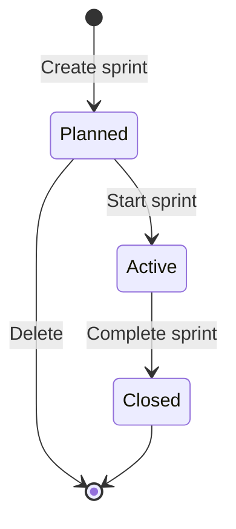

# How sprints and epics work

Sprints decide which cards a project works now; epics group cards that serve one goal. This page explains how both work and how they meet, for anyone who plans a project.

## Key concepts

**Sprint**: a set of cards planned to be worked together. It goes from planned to active to closed, and never back.

**Active sprint**: the one sprint being worked. While it runs, the board shows only its cards and agents are handed only its cards.

**Backlog**: the cards that belong to no sprint. A card goes back there whenever it leaves a sprint unfinished.

**Epic**: a card of category `epic` that groups other cards. By default it is never worked itself: its children are.

**Checkpoints**: an epic's cards in the order they are built. A card blocked by a sibling comes after it, and the epic's test card comes last.

**Execution mode**: how agents work a project's cards. `card`, the default, hands out each card on its own. `epic` hands out an open epic as one unit, so one agent session builds all its cards in order.

## Overview

A sprint moves one way, and its unfinished cards always find a new place:

Only one sprint is active at a time. To start another, complete the active one first.

### Plan a sprint

Open **Backlog** in the project's sidebar and select **Create sprint**. Drag cards between the sprint and the backlog, or use a card's **Move to…** menu. Select the chevron by a sprint's or the backlog's name to fold its cards away; a folded block keeps its name, its count and its actions, still takes a dropped card, and stays folded in this browser. Select **Start** to make it the active sprint. The dialog fills in the start date you planned for the sprint; with none, it starts today.

To finish, select **Complete**. Cards in **Deploy** or **Completed** stay with the closed sprint. Every other card moves where you choose under **Move them to**: the backlog or a planned sprint.

### Group cards under an epic

A card joins an epic through its `epic` field, which holds the epic's key, like `OFF-12`, or the epic's label. A label names an epic only when exactly one epic carries it. The board shows each child with its epic's badge; set the field through the MCP server or the API.

An epic is never planned into a sprint and never set running. With no children, it can only be in **Refine**. In `card` mode it is never handed to an agent either.

Open an epic to see its **Checkpoints**: its cards in build order, each pending, in progress or completed, and how many are completed. Its card on the board shows the same count, such as 3/5. A checkpoint is completed once its card is built. Review and release follow.

### Work an epic in one session

The project's owner sets the execution mode under **Configuration** > **Work rules** > **How agents work this project**. With **Epic by epic**:

- The next card an agent asks for, if it belongs to an open epic and waits in To do, In progress or Review, is handed out as its epic, with a `sweep`: the phase, the role, the run and the checkpoints. No other session takes one of its cards alone.
- One implementer role builds every checkpoint, in one session on one model. Each card's specialty, such as UI states or safe migrations, comes as the mods listed on its checkpoint.
- The agent marks each checkpoint in progress and then completed with `cards.setCheckpoint`. Each card moves to In progress and then to Review, as if it had been moved by hand.
- Once no checkpoint is left to build, the epic is reviewed as a whole. Each card is approved or sent back on its own.
- Spikes, cards for a person, and the Refine, Ready and Deploy steps are still handed out card by card.

Switching changes no card. Switch back to **Card by card** at any time.

### When a sweep waits, and when it resumes

- A checkpoint that waits only on cards the sweep already built is ready: their work is on the epic's branch, so the sweep does not show it as blocked. The epic's test card runs that way, after its siblings and before the review.
- An epic whose remaining work waits on a person is not handed out until the person answers. Its cards in Refine are still handed out, each on its own.
- An agent that resumes an epic it was already working reads it with `cards.unit`, which answers the same `sweep` as the hand-out, so it resumes in the right phase.

### The epic test card

The **Testing** category describes one convention for epics: a test card, tagged `epic-test`, runs the full test suite once, after the epic's other cards. In checkpoint order it is always last. Officium does not hold it back in `card` mode: to make it come last there, link each of the epic's cards to it with **Blocks**.

## FAQ

### Why is an epic missing from the board during a sprint?

The board shows only the active sprint's cards, and an epic is never in a sprint. Its children still carry its badge.

### Why work an epic in one session?

Each new session reads the project again before it can work. An epic built in one session reads it once, keeps what it learned from card to card, and keeps the same model throughout. Long sessions compact their history on their own, and every checkpoint ends in a commit and a board update, so nothing is lost.

### What happens to a card's time when a sprint closes?

Nothing. Time stays on the card, and the **Contributions** page can measure any sprint that has started.

## Next steps

- [How projects, folders and the board work](./organization.md) — the board an active sprint narrows.
- [How categories and their rules work](./categories.md) — the epic and testing categories in full.
- [How time, tokens and metrics work](./time-and-metrics.md) — measure what a sprint delivered.
