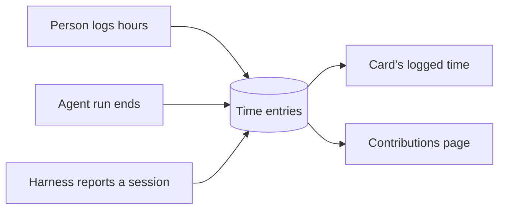

# How time, tokens and metrics work

Every hour on a card is a time entry, logged by a person or imputed from an agent's work. This page explains where entries come from and what the **Contributions** page computes from them, for anyone who reads a project's numbers.

## Key concepts

**Time entry**: a number of hours on one card for one date, with who did the work and a note. A card's logged time is the sum of its entries.

**Source**: where an entry comes from. A person logs a `manual` entry; an agent's run or session gets an imputed one.

**Concept**: whether the hours went to `refine` or to `work`. Time spent while the card sat in **Refine** counts as refinement.

**Tokens**: what an agent's model read and wrote during a session, reported by its harness. Only session entries carry tokens.

## Overview

Hours reach a card along three paths, and the metrics read all of them:

A session reported by the agent's harness is the most precise path. Where one covers a span, it replaces the time imputed from the run for that span.

### Hours logged by a person

Open a card and select the hours under **Estimate / logged** to open **Time tracking**. Enter the **Date**, the **Hours** and what you did under **Work done**, then select **Log**. Logging time needs edit access to the project.

### Hours imputed from agent work

When an agent's run ends, Officium imputes its length as an entry, with a note like `Imputed from <agent>'s run`. A run shorter than 1 minute imputes nothing. An entry never crosses midnight UTC or a move in or out of **Refine**: it is cut into one entry per day and concept.

When the agent's harness reports its session, the entries carry the model, the effort and four token counts. A subagent's work gets its own entries, attributed to the card that was being worked when the subagent started.

### What the Contributions page shows

Open **Contributions** in the project's sidebar. The **Metrics** tab measures a date range or a sprint:

- **Delivered**: cards that first reached **Review** or later in the period, and were not rejected since. Delivered means delivered and kept, so a card rejected later leaves the count, even a past period's.
- **Hours total**, **Manual hours** and **Agent hours (imputed)**, with the split between refinement and work.
- **Agent tokens by model**: tokens in, cached, out and thinking, per model, and an **Est. cost** column: what those tokens would cost at the providers' API list prices, in USD. It is an estimate for a subscription that charges a flat fee, not a bill. A model with no price shows "no price" and is named, never guessed.
- **Contributions**: what each person and agent delivered and logged, with the same estimate per contributor.
- **By category**: deliveries, mean cycle time and mean logged hours per category.
- **Longest open**: the oldest unfinished cards, rejected ones left out.
- **Rejected** and **Sent back**: the cards rejected, and the send-backs from review or deploy, in the period. Both are counted by reason and by category, where the backlog and its reviews fail.

Sent back also shows the share of cards that passed review the first time. A send-back naming several reasons counts once for each, so the reasons can add up to more than the total. A send-back does not change Delivered: a card is delivered once, at its first handover.

### By AI profile

Every status change keeps who ran the phase the card left: the project's active work profile then, the role the agent named on the move, and that role's model and effort. An agent session's time keeps the profile too. **By AI profile** lays each review, send-back and escaped defect of the period on the profile that ran the card's **Action** (its **Refine** when it skipped Action):

| Column | What it counts |
| --- | --- |
| Reviewed | Exits from review: approvals and send-backs. |
| First-time pass | Cards whose first review was an approval. |
| Code health | Reviews with no architecture or clean-code violation. |
| Violations | Engineering rules named by send-backs. |
| Escaped | Defects a later corrective card traced back to these cards, by the phase that let them through. |
| Time | Hours under the profile, plus the debt: the hours of the corrective cards that name its cards. |
| Per clean delivery | Hours, debt included, per card approved the first time and named by no defect. Tokens are averaged over the clean deliveries whose card recorded some, not over all of them. |

Under the table, **Reviewer catch rate** compares, for each reviewing model, the violations it caught with the defects that escaped its review. An Action cell, a category under one profile and model, gets a suggestion to raise its model, Haiku to Sonnet or Sonnet to Opus, when at least 30% of 5 or more reviews broke an architecture or clean-code rule. A clean cell keeps its cheaper model. The list of escaped defects links each origin card to its corrective card.

Cards moved before Officium kept phase runs are left out.

### Tokens cover only some deliveries

Tokens come from agent sessions, and a delivery nobody reported a session for has none. The per-card token figures average over the deliveries whose card recorded tokens, so a period where most deliveries have none does not read as cheap. Under the token figures the page says how many deliveries, and how many agent hours, recorded tokens. Below 80% of either, it says the per-card figures cover only those. Hours are counted on the same basis, with manual hours left out, since a person's hours never carry tokens.

Select **Compare two periods** to put two weeks or two sprints side by side. The **Time report** tab lists every entry in a range, with totals by person, ready to print.

## Examples

### Read the token columns

**In** counts input read at full price, fresh input and cache writes. **Cached** counts input read from the prompt cache. **Thinking** is the part of **Out** the model spent reasoning, so it is never added on top of **Out**.

## FAQ

### Does Officium estimate what agent work costs?

Only as a value, and only on the Value tab. It prices each model's tokens at its published API price, on the day they were spent, and says how many rows it could not price. It never prices a model it has no price for. That API-equivalent figure is what the same usage would cost at API rates, not what your subscription charged.

### What is the Value tab?

The Value tab of Contributions shows one month: the cards delivered, the agent hours and how many of them ran with nobody at the keyboard, the API-equivalent value of the usage, and what that is per subscription dollar. Set your own monthly subscription price there; only you see it. Until you set it, the two ratios wait for it.

### Why does a card show imputed hours?

A card delivered in the month with no measured agent time takes its category's mean measured hours, and the Value tab counts how many cards did. Typed hours are never imputed.

### Why is mean logged hours different from the period's hours?

Mean logged hours counts all of a card's time, ever. The hour tiles count only the entries dated inside the period.

### Can I edit a time entry?

Not from the card yet. **Time tracking** logs and deletes entries; to correct one, delete it and log it again.

## Next steps

- [How live status and the heartbeat work](./live-status.md) — the sessions that agent time is imputed from.
- [How sprints and epics work](./sprints-and-epics.md) — the sprints the metrics can measure.
- [Card fields reference](./card-fields.md) — every field of a card, the estimate included.
