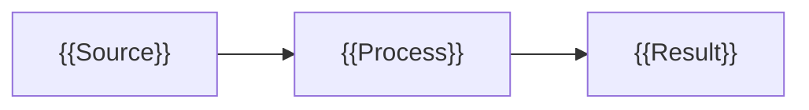
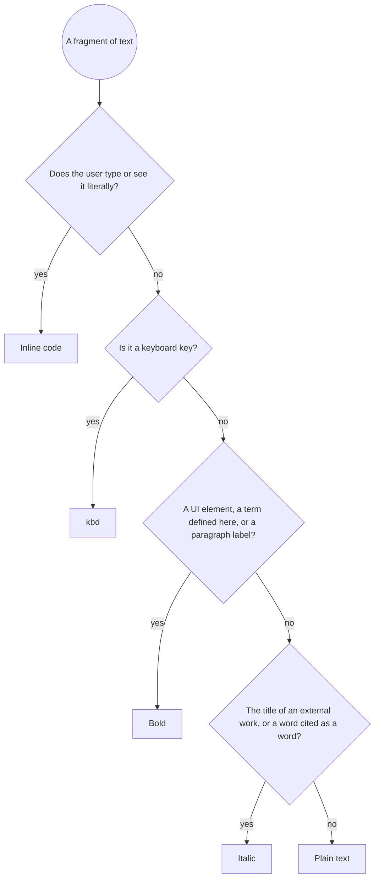
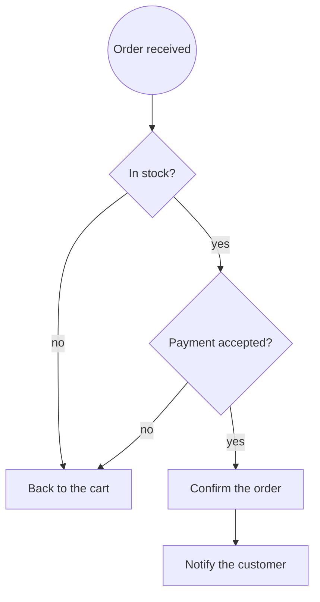
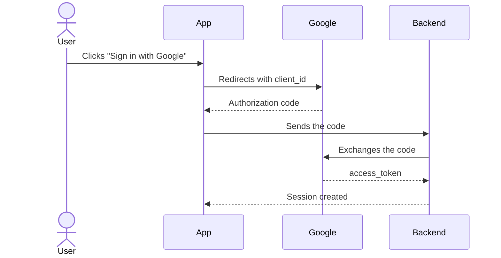

<!--
Officium's documentation page schema: part of the documentation contract, served to agents by
docs.schema (JAVA-781). NOT a documentation page: it is never listed in a project's or Officium's
built-in Documentation (user decision, 2026-10-02).

Source: the user's schema, written in Spanish on 2026-10-02, translated. The decision tree under
"Inline formatting" did not survive the paste and was rebuilt from its table; the user confirms it
before the schema is final (JAVA-784).
-->

# Documentation page schema

The contract every documentation page in Officium follows, written by a person or by an agent. It says which of four types a page is, which sections that type needs and in what order, and how to format, block and word its content.

## How to use this schema

Each page answers one reader question and is one of four types; the type decides which sections are required. Pick the type first, then fill the template in its fixed order.

Four principles govern everything else:

- **One page, one purpose.** If a page teaches and is also a lookup, split it in two and link them. Measured, a page holds one purpose when every H2 is a section of the matrix, it takes no more of them than its type allows (9 for tutorial and how-to, 7 for reference, 5 for explanation, 9 with no valid type), and it stays under 38,000 characters with no section over 33,000. To split: each section that belongs elsewhere moves to a page of its own under this page's path, and the page keeps its lead and a list of links to them. `docs.lint` names each breach (`section.unknown`, `section.count`, `page.length`, `section.length`).
- **What matters, in the first three lines.** The title and the lead are enough for the reader to know whether they are on the right page.
- **Scannable before readable.** The reader jumps between headings, lists and tables; prose only joins the pieces.
- **Everything literal is copyable.** What the user types or sees on screen always goes in code formatting, never in plain text.

### Page types

| Type (`type`) | Reader's question | Title form | Example title |
| --- | --- | --- | --- |
| `tutorial` | "I want to learn by doing" | Verb + tangible result | Build your first API with Quarkus |
| `how-to` | "I want to get X done now" | Verb + concrete goal | Set up sign-in with Google |
| `reference` | "I need the exact fact" | Noun: "… reference" | Orders API reference |
| `explanation` | "I want to understand why" | "How … works" or "Why …" | How the session cache works |

### Sections by type

Sections always appear in this order; the ones that do not apply are left out, never left empty.

| # | Section | Tutorial | How-to | Reference | Explanation |
| --- | --- | --- | --- | --- | --- |
| 1 | Frontmatter | Required | Required | Required | Required |
| 2 | Title (H1) | Required | Required | Required | Required |
| 3 | Lead | Required | Required | Required | Required |
| 4 | Status notice | If `status` ≠ `stable` | If `status` ≠ `stable` | If `status` ≠ `stable` | If `status` ≠ `stable` |
| 5 | Prerequisites | Required | Required | — | — |
| 6 | Key concepts | Optional | — | — | Required |
| 7 | Overview (diagram) | Optional | Optional | Optional | Required |
| 8 | Steps | Required | Required | — | — |
| 9 | Check the result | Required | Required | — | — |
| 10 | Examples | Optional | Optional | Required | Optional |
| 11 | Reference (tables) | — | Optional | Required | — |
| 12 | Troubleshooting | Optional | Required | Optional | — |
| 13 | FAQ | Optional | Optional | Optional | Optional |
| 14 | Next steps | Required | Required | Optional | Required |
| 15 | Changelog | — | — | Optional | — |

## Formal schema

A page is a `DocPage` object: the order of its properties is the order they appear in the Markdown, and every array carries its cardinality. If a list goes over its maximum, the page has two purposes and must be split.

```ts
// Cardinality: [n] exactly n · [a..b] between a and b · ? optional
// The order of the properties IS the order in the Markdown.

type DocType = "tutorial" | "how-to" | "reference" | "explanation";

interface DocPage {
  frontmatter: Frontmatter;        // [1]     see Frontmatter
  title: Heading<1>;               // [1]     identical to frontmatter.title
  lead: Paragraph;                 // [1]     1–3 sentences: what it is, for whom, what they get
  statusNotice?: Admonition;       // [0..1]  only if status ≠ "stable"
  prerequisites?: Prerequisite[];  // [1..7]  ## Prerequisites
  concepts?: Concept[];            // [2..6]  ## Key concepts
  overview?: Overview;             // [0..1]  ## Overview
  steps?: Step[];                  // [2..10] ## Steps (more than 10 → split the page)
  verification?: Verification;     // [0..1]  ## Check the result
  examples?: Example[];            // [1..5]  ## Examples
  reference?: ReferenceGroup[];    // [1..n]  ## Reference
  troubleshooting?: Issue[];       // [1..10] ## Troubleshooting
  faq?: FaqItem[];                 // [2..8]  ## FAQ
  nextSteps?: RelatedLink[];       // [1..5]  ## Next steps
  changelog?: ChangelogEntry[];    // [1..n]  ## Changelog, newest first
}

// ── Primitives ──
type Heading<L extends 1 | 2 | 3 | 4> = string; // "#" × L + text; sentence case, no final period
type Paragraph = string;                         // 1–4 sentences, ≤ 25 words each, one idea
type InlineCode = `\`${string}\``;
type Bold = `**${string}**`;
type Url = string;                               // relative for internal pages: ./other-page.md

// ── Sections ──
interface Prerequisite {           // unordered list, one requirement per item
  item: string;                    // noun or "Have…": "Java 21 or later"
  version?: InlineCode;            // minimum version: `21`
  link?: Url;                      // where to get it
}

interface Concept {                // one paragraph per concept
  term: Bold;                      // **Term**: bold only here
  definition: Paragraph;           // 1–2 sentences, not repeating the term itself
}

interface Overview {
  intro: Paragraph;                // announces the diagram, ends in ":"
  diagram: MermaidDiagram;         // [1]
  reading: Paragraph;              // 1–2 sentences: what the reader should see in the diagram
}

interface Step {
  heading: Heading<3>;             // "### 1. Install the SDK": number + imperative + object
  purpose: Paragraph;              // 1–2 sentences: what you do and what for
  actions?: string[];              // [2..6] ordered list when there are UI sub-actions
  code?: CodeBlock[];              // [0..2]
  result?: Paragraph | CodeBlock;  // what the user should see when the step is done
  admonition?: Admonition;         // [0..1]
}

interface Verification {
  intro: Paragraph;
  check: CodeBlock;                // command or action that checks
  expectedOutput: CodeBlock;       // lang "text" or "console"
}

interface Example {
  heading: Heading<3>;             // names the case: "### Paginate results"
  context: Paragraph;              // when to use it
  code: CodeBlock;                 // [1] complete and runnable as is
  output?: CodeBlock;
}

interface ReferenceGroup {
  heading: Heading<3>;             // "### Query parameters", "### Environment variables"
  intro?: Paragraph;
  rows: Parameter[];               // [1..n] one Markdown table, one row per element
}

interface Parameter {              // table columns, in this order
  name: InlineCode;                // `pageSize`
  type: InlineCode;                // `integer`
  required: "Yes" | "No";
  default: InlineCode | "—";       // `20`
  description: string;             // capitalized, one sentence
}

interface Issue {
  symptom: Heading<3>;             // literal error message in code, or the visible symptom
  cause: Paragraph;                // starts with "**Cause:**"
  solution: Paragraph | Step[];    // starts with "**Solution:**"
}

interface FaqItem {
  question: Heading<3>;            // a real user question, ends in "?"
  answer: Paragraph;               // the first sentence already answers: "Yes.", "No." or the fact
}

interface RelatedLink {            // unordered list
  text: string;                    // the target page's title, never "here"
  href: Url;
  why: string;                     // after " — ": what they will find there, one sentence
}

interface ChangelogEntry {         // table: Date | Version | Change
  date: string;                    // YYYY-MM-DD
  version: InlineCode;
  change: string;                  // past participle: "Added…", "Removed…"
}

// ── Reusable elements ──
interface CodeBlock {
  intro: Paragraph;                // the sentence before ends in ":"
  lang: CodeLang;                  // required, never empty
  kind: "command" | "source" | "config" | "output";
  filename?: string;               // first line as a comment: // src/App.java
  body: string;                    // ≤ 30 lines; more → link the full file
  placeholders?: Placeholder[];    // explained right after the block
}

interface Placeholder {
  token: `<${Uppercase<string>}>`;  // <API_KEY>
  meaning: string;
}

type CodeLang =
  | "bash" | "powershell" | "console" | "text"
  | "json" | "yaml" | "toml" | "properties" | "xml" | "http" | "sql"
  | "ts" | "tsx" | "js" | "java" | "python" | "dockerfile" | "diff";

interface Admonition {
  kind: "NOTE" | "TIP" | "IMPORTANT" | "WARNING" | "CAUTION";
  body: Paragraph;                 // 1–3 sentences
}

interface MermaidDiagram {
  kind: "flowchart" | "sequenceDiagram" | "stateDiagram-v2" | "erDiagram" | "classDiagram";
  accTitle: string;                // required
  accDescr: string;                // required
  maxNodes: 12;
}
```

## Frontmatter

The frontmatter is a YAML block at the top of the file, between two `---` lines, with eleven fields: six required and five optional. Arrays are always written as YAML lists, one element per line.

| Field | Type | Required | Values or rule |
| --- | --- | --- | --- |
| `title` | `string` | Yes | Same as the H1, ≤ 60 characters, no final period |
| `description` | `string` | Yes | 120–160 characters, a full sentence with the result the reader gets |
| `type` | `enum` | Yes | `tutorial`, `how-to`, `reference`, `explanation` |
| `status` | `enum` | Yes | `draft`, `beta`, `stable`, `deprecated` |
| `audience` | `string[]` [1..3] | Yes | `developer`, `admin`, `end-user` |
| `last_updated` | `date` | Yes | `YYYY-MM-DD`, changed with every content change |
| `level` | `enum` | No | `beginner`, `intermediate`, `advanced` |
| `tags` | `string[]` [1..6] | No | Lowercase kebab-case |
| `product_version` | `string` | No | The product version the page documents |
| `owner` | `string` | No | The team or person who maintains it |
| `related` | `string[]` [0..5] | No | Relative paths to other pages |

```yaml
---
title: "Set up sign-in with Google"
description: "Connect your app to Google OAuth 2.0 so users sign in with their Google account in under ten minutes, from keys to the first login."
type: how-to
status: stable
audience:
  - developer
last_updated: 2026-10-02
level: intermediate
tags:
  - auth
  - oauth
product_version: "2.3"
owner: "platform-team"
related:
  - ./manage-sessions.md
  - ./auth-api-reference.md
---
```

## Template

The template holds every section in its order; delete the ones your type marks "—" in the matrix. Each `{{…}}` slot is replaced whole, braces included.

````markdown
---
title: "{{Verb + goal}}"
description: "{{120–160 characters with the result the reader gets}}"
type: how-to
status: stable
audience:
  - developer
last_updated: {{YYYY-MM-DD}}
tags:
  - {{tag}}
related:
  - ./{{related-page}}.md
---

# {{Title identical to frontmatter.title}}

{{Lead: what it is, for whom and what they will have at the end. Three sentences at most.}}

> [!WARNING]
> {{Only if status ≠ stable: what it implies and what to use instead.}}

## Prerequisites

- {{Tool}} `{{x.y}}` or later. [Install {{tool}}]({{url}})
- A {{service}} account with the **{{Role}}** role.
- {{Prior knowledge needed}}.

## Key concepts

**{{Term}}**: {{definition in one or two sentences}}.

**{{Term}}**: {{definition in one or two sentences}}.

## Overview

{{Sentence announcing the diagram}}:



{{What the reader should notice in the diagram.}}

## Steps

### 1. {{Imperative verb + object}}

{{What you do and what for.}} Run:

```bash
{{command}} --{{option}} <{{PLACEHOLDER}}>
```

Replace `<{{PLACEHOLDER}}>` with {{which value and where to get it}}.

### 2. {{Imperative verb + object}}

{{What you do and what for.}}

1. Open **{{Menu}}** > **{{Submenu}}**.
2. In the **{{Field name}}** field, type `{{value}}`.
3. Click **{{Button}}**.

> [!TIP]
> {{Optional shortcut or alternative.}}

### 3. {{Imperative verb + object}}

{{What you do and what for.}} Add this to `{{path/to/file}}`:

```yaml
# {{path/to/file}}
{{key}}: {{value}}
```

## Check the result

Run:

```bash
{{check command}}
```

You should see output like this:

```text
{{expected output}}
```

## Examples

### {{Concrete use case}}

{{When this example helps you.}}

```{{language}}
{{complete code, runnable as is}}
```

## Reference

### {{Parameters, environment variables or options}}

| Name | Type | Required | Default | Description |
| --- | --- | --- | --- | --- |
| `{{name}}` | `{{type}}` | Yes | — | {{One sentence}} |
| `{{name}}` | `{{type}}` | No | `{{value}}` | {{One sentence}} |

## Troubleshooting

### `{{Literal error message}}`

**Cause:** {{why it happens}}.

**Solution:** {{what to do, or numbered steps}}.

## FAQ

### {{A real user question}}?

{{Yes. / No. / The fact.}} {{Short explanation.}}

<details>
<summary>{{Detail only a minority needs}}</summary>

{{Optional long content.}}

</details>

## Next steps

- [{{Page title}}](./{{page}}.md) — {{what they will find there}}.
- [{{Page title}}](./{{page}}.md) — {{what they will find there}}.

## Changelog

| Date | Version | Change |
| --- | --- | --- |
| {{YYYY-MM-DD}} | `{{x.y}}` | {{Added… / Removed…}} |
````

## Inline formatting

Each fragment carries one format at most, and what the fragment *is* decides it, not how much it matters. The tree sums up the decision; the table gives the detail.



Ask first whether it is a technical literal; only if it is not, decide between bold, italic or plain text. Underline and strikethrough appear on no branch.

| Format | Syntax | Use it for | Never for | Example |
| --- | --- | --- | --- | --- |
| Bold | `**text**` | UI elements the user clicks or reads (buttons, menus, tabs, fields); a term the time it is defined; paragraph labels like **Cause:**; the negation in a risk notice | Whole sentences, decorative emphasis, code identifiers, headings | Click **Save changes**. |
| Italic | `*text*` | Titles of external works or documents; a word cited as a word | Emphasis (use bold, sparingly), common technical terms | See the *Production security* guide. |
| Inline code | `` `text` `` | Every literal the user types or sees: short commands inside a sentence, files and paths, variables, functions, classes, parameters, config keys, values, environment variables, flags, ports, HTTP methods and codes, packages, short error messages | Product names as concepts (Docker, React), button text, emphasis, URLs the user must open, anything that fills a whole line | Set `DATABASE_URL` in `.env`. |
| Underline | `<u>text</u>` | Nothing: forbidden | Everything; readers take it for a link | — |
| Strikethrough | `~~text~~` | Nothing: what is obsolete is deleted or marked with a `[!WARNING]` notice | Everything | — |
| Link | `[text](url)` | Pointing to another page or section; text = the target's title or a concrete action; relative paths or `doc://<path>` for internal pages | "Here", "this link", bare URLs in prose, repeating the same target in one section | Follow *Manage sessions*. |
| Mention | `[@Name](member://<accountId>)` | A member of the project the text concerns; the editor's `@` writes it, and an agent resolves the id with `members.list` | An email address, a team, someone outside the project | Ask @Ana before the release. |
| Key | `<kbd>Ctrl</kbd>` | Keyboard shortcuts, one key per `<kbd>`, joined with `+` | UI buttons (bold) | Press <kbd>Ctrl</kbd>+<kbd>S</kbd>. |

### Combination and density rules

- **Never nest formats.** No bold code, no bold italics. The one exception: code inside a link whose target documents that identifier, like [`pageSize`](#pagesize).
- **Label in bold, value in code.** In the **Port** field, type `8080`: what the user reads is bold, what they type is code.
- **Menu paths with `>`.** Open **Settings** > **Security** > **API keys**, each item in its own bold.
- **Code in headings, in two cases only.** On reference pages, when the heading is the identifier; in Troubleshooting, when it is the literal error message.
- **Maximum density.** Two bolds per paragraph; with more than four inline codes in a paragraph, turn it into a list or a table.
- **Placeholders with a fixed shape.** `<API_KEY>`: uppercase, underscores and angle brackets, explained in the next sentence.

## Blocks

A block comes in when the content has a shape of its own: code to copy, a sequence, several elements with attributes, or a risk to warn about. If it fits in a sentence, it goes in a sentence.

### Code block

It comes in three cases: the content fills a whole line or more, the user will copy and run it even if it is a single command, or it is terminal output, a file's content, an HTTP request or a diff.

- **Always a language on the fence.** Never an empty fence; text with no highlighting is `text`.
- **Command and output, in separate blocks.** The command has no `$` prompt so it copies clean; to show a session with its output together, use `console` with `$`.
- **One command per line**, with no comments the user has to delete before running it.
- **The file's path on the first line** as a comment when the block is a file's content.
- **30 lines at most.** If longer, show the relevant fragment, mark what is left out with `// …` and link the full file.
- **A sentence before, the explanation after.** Before, a sentence ending in ":" that says what the block does; after, the placeholders and the expected result. Never two blocks in a row with no text between them.
- **Highlighting a change inside code** uses the `diff` fence with `+` / `-` lines; bold and underline do not work inside a block.

| Content | Fence |
| --- | --- |
| A shell command to copy | `bash` (`powershell` on Windows) |
| A session with prompt and output | `console` |
| Output, logs or plain text | `text` |
| A configuration file | `yaml`, `json`, `toml`, `properties` |
| An HTTP request or response | `http` |
| Changes to existing code | `diff` |
| A diagram | `mermaid` |

### Lists

- **Ordered (`1.`) when order matters:** steps and sequences. Really number them (`1.`, `2.`, `3.`) so the source reads too.
- **Unordered (`-`) when it does not:** requirements, options, features. Always `-`, never `*` or `+`.
- **Between 2 and 7 items.** With one, write a sentence; with more than seven, use a table or subsections.
- **Two levels at most**, indented 4 spaces; a code block inside an item takes the same indent.
- **Parallel structure:** every item starts with the same kind of word. A full sentence ends with a period; a fragment does not, the same across the list.

### Tables

They come in when three or more elements share two or more attributes: parameters, comparisons, compatibility.

- **The first column is the identifier** the reader looks for.
- **Short headers with their unit:** `Time (ms)`.
- **One sentence per cell at most**, no lists or code blocks inside; an empty cell is "—".
- **A useful order:** alphabetical in a reference; in parameters, the required ones first.
- **Six columns at most.** Never to lay out prose, nor for a single element.

### Notices

Use GitHub's syntax, which also reads well as plain text:

```markdown
> [!WARNING]
> Changing the port disconnects the active clients.
```

| Type | When it comes in | Example |
| --- | --- | --- |
| `NOTE` | Useful information that does not change the result | The configuration reloads without a restart. |
| `TIP` | A better or optional way to do something | Add `--dry-run` to preview the changes. |
| `IMPORTANT` | Something essential to succeed | The token expires after 60 minutes. |
| `WARNING` | A risk of an error or unexpected behavior | Changing the port disconnects the active clients. |
| `CAUTION` | A destructive or irreversible action | This command deletes the database and **cannot** be undone. |

- **One per section at most**, never two in a row, one to three sentences.
- **Before the point of risk:** `WARNING` and `CAUTION` go before the command, never after.
- **Nothing essential inside a `NOTE`.** If the user needs it to move on, it goes in the step itself.

### Disclosures

`<details>` comes in for content only a minority needs: long output, edge cases, background. Never for required steps or notices. Leave a blank line after `</summary>` so the Markdown inside renders.

### Images

- **Only when text is not enough:** locating an element in a complex interface, or showing a visual result.
- **Never a screenshot of code or text:** that goes as text or as a code block.
- **Alt text that describes what is seen:** ``.
- **A file of the page, with a kebab-case name:** upload the image to the page (paste it, drop it, `/image`, Attach, or `docs.attachments.upload`) and use the `doc://<page>/_files/<name>` address that comes back. A remote or relative source is never drawn (`image.source`). Crop the screenshot to the relevant area.
- **Size is the server's job:** an image is reduced on upload with no visible loss and stripped of its metadata, so upload the original.
- **Diagrams in Mermaid, not as images**, so they are maintained next to the code.

### HTML and separators

The HTML allowed is limited to `<kbd>`, `<details>` and `<summary>`. The `---` line is reserved for the frontmatter; in the body, headings already separate.

## Mermaid diagrams

A diagram comes in when there are branches, loops, parallel steps, more than two actors, or relations between three or more components. A linear sequence with no branches is an ordered list, not a diagram.

| What you want to show | Type | Example of use |
| --- | --- | --- |
| A process with decisions or branches | `flowchart TD` | Validating an order |
| How the components connect | `flowchart LR` with `subgraph` | Frontend, API and database |
| Messages between actors over time | `sequenceDiagram` | Signing in with OAuth |
| States and transitions of an entity | `stateDiagram-v2` | An invoice's lifecycle |
| A data model and its relations | `erDiagram` | Customer, order and order line |
| Classes and interfaces | `classDiagram` | A hierarchy of services |

### Rules

- **`accTitle` and `accDescr` always.** They are what screen readers read; `accDescr` sums up the conclusion, it does not list the nodes.
- **12 nodes at most.** With more, split into two diagrams or go up one level of abstraction.
- **Direction by shape:** `LR` for few steps with short labels, `TD` for long chains and trees.
- **Short IDs with no spaces, labels in quotes:** `api["Orders API"]`.
- **Shapes with a fixed meaning:** `[ ]` process, `{ }` decision, `[( )]` database, `(( ))` start or end.
- **Labels on arrows only when the relation is not obvious:** `-->|yes|`.
- **No `style` or `classDef`:** the site's theme decides the colors. The exception: a single highlighted node.
- **The same names as the text.** If the prose says "Orders API", the node says "Orders API".
- **Never the only source.** A sentence announcing it before; one or two sentences after with the conclusion the reader should draw.

### Example: a process with a decision

````markdown

````

### Example: a sequence between actors

````markdown

````

## Writing

The reader understands at first reading when each sentence has one idea, a clear subject, and the purpose before the action. Sentences of 25 words at most, paragraphs of four sentences at most.

| Rule | Avoid | Write |
| --- | --- | --- |
| Second person and imperative in steps | The command must be run | Run the command |
| Present tense | The server will return a token | The server returns a token |
| Active voice | The file is generated by the CLI | The CLI generates the file |
| Purpose and condition before the action | Click **Delete** if you want to remove it | To remove it, click **Delete** |
| No minimizers | Simply add the key | Add the key |
| One term per concept | Alternating "endpoint" and "route" | Pick one and keep it across the page |
| Numbers with their unit | Wait thirty seconds | Wait 30 seconds |
| Names, not positions | The button at the top right | **Settings** |
| No relative dates | The new version lets you… | Since version `2.3`, you can… |
| Acronyms spelled out the first time | Turn on SSO | Turn on single sign-on (SSO) |
| Headings in sentence case, no period | ### Database Configuration. | ### Configure the database |

## Checklist before publishing

A page is ready when it passes every check; the last one is what really measures whether the user understands it.

- [ ] The frontmatter has the six required fields and `title` matches the H1.
- [ ] There is a single H1 and no skipped heading level.
- [ ] The lead says what it is, for whom and what they get, in three sentences at most.
- [ ] The sections follow the matrix's order and none is empty.
- [ ] Every H2 is a section of the matrix, the count is within the type's allowance, and no page or section passes its length (see "One page, one purpose").
- [ ] Every literal the user types or sees is in inline code or a block.
- [ ] UI elements are bold, and nothing else is without a rule that justifies it.
- [ ] There is no underline, strikethrough or nested formatting.
- [ ] Every code block has a language, an intro sentence and 30 lines at most.
- [ ] Every `<PLACEHOLDER>` is explained right after its block.
- [ ] The commands were run exactly as written and produce the output shown.
- [ ] Every diagram has `accTitle`, `accDescr`, 12 nodes at most and a reading sentence.
- [ ] No notice sits next to another, and the risk ones come before the step they affect.
- [ ] The links work and their text describes the target.
- [ ] Every image has alt text that describes what it shows.
- [ ] `last_updated` has the date of this change.
- [ ] Someone who does not know the product completes the page without having to ask anything.
