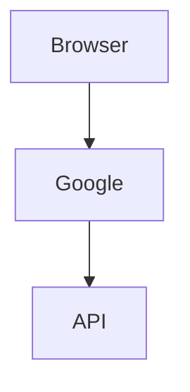

# Set up sign-in with Google

> [!NOTE]
> Sign-in uses the account you already have.

> [!TIP]
> Keep the console open in a second tab.

> [!IMPORTANT]
> The redirect URI must match **exactly**.
>
> Trailing slashes count.

> [!WARNING]
> Changing the port disconnects the active clients.

> [!CAUTION]
> Deleting the key signs everyone out.

## Overview



## Steps

Press <kbd>Ctrl</kbd>+<kbd>S</kbd> to save, then reload.

```mermaid
flowchart TD
  this is not --> a valid [diagram
```

## FAQ

### Can I use another provider?

No.

<details>
<summary>Why only <kbd>Google</kbd>?</summary>

Because the **account** is shared across apps.

- One login
- One session

</details>

<details open>
<summary>Already open</summary>

Shown expanded.

</details>
